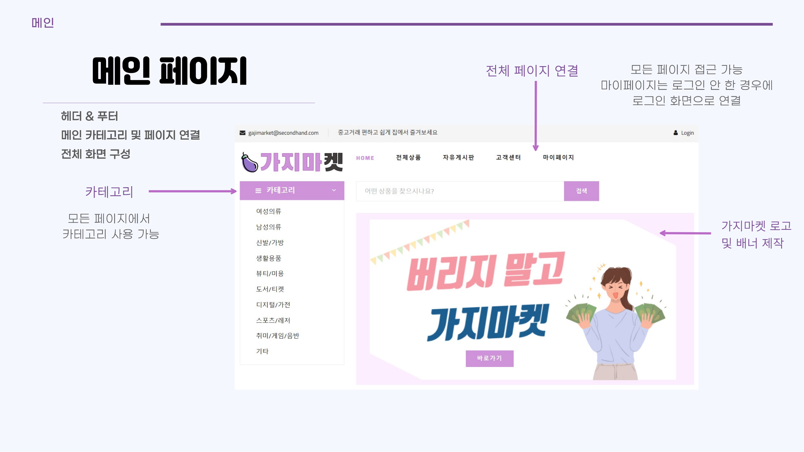
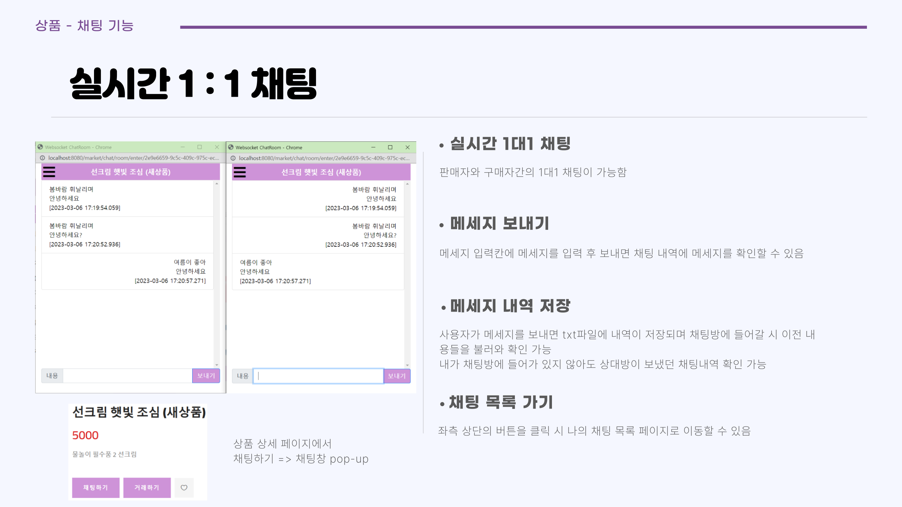
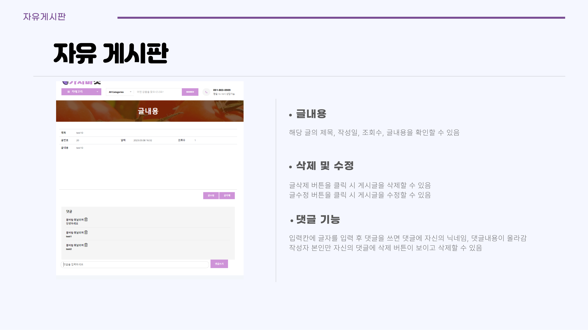
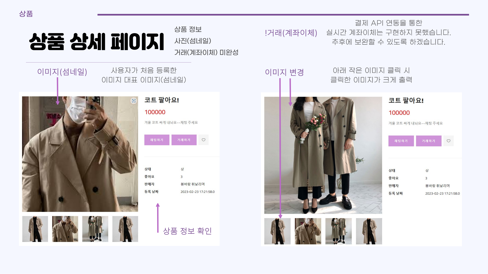
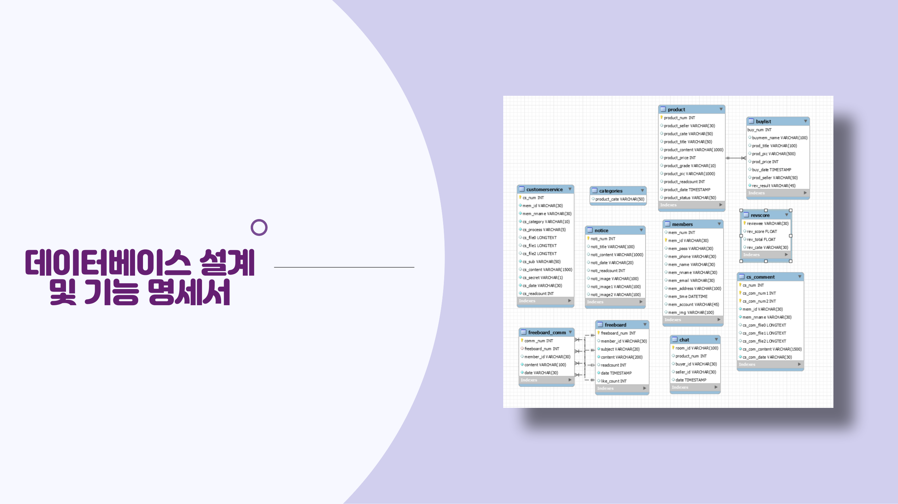

# 🍆 가지마켓 (GajiMarket) - P2P 중고거래 플랫폼

> **"나가지말고 집에서 편하게 중고거래"**  
> 당근마켓과 번개장터를 벤치마킹하여 개발한 웹 기반 1:1 P2P 중고거래 플랫폼입니다.  
> 실시간 1:1 웹소켓 채팅, 상품 등록·검색·찜하기, 자유게시판(비동기 댓글), 고객센터 Q&A 등 중고거래에 필요한 핵심 기능을 구현하였습니다.

<br>

<div align="center">
  
  
  
  
  
  
  
  
</div>

<br>

---

## 📸 핵심 화면 미리보기

| 메인 페이지 | 실시간 1:1 채팅 |
|:---:|:---:|
|  |  |
| **조회순·관심순·최신순 캐러셀 & 카테고리 탐색** | **WebSocket+STOMP 기반 실시간 1:1 채팅창** |

| 자유게시판 & 댓글 | 상품 상세 페이지 |
|:---:|:---:|
|  |  |
| **자유게시판 CRUD 및 AJAX 비동기 실시간 댓글** | **상품 갤러리, 판매자 다른 상품 추천, 채팅 연동** |

<br>

---

## 🗓 프로젝트 정보

- **개발 기간**: 2023.02.01 ~ 2023.03.17 (약 7주)
- **팀 구성**: 6명 (아이티윌 부산캠퍼스 파이널 프로젝트 1조)
- **담당 역할 분담**:

| 구분 | 팀원 | 담당 업무 |
|:---:|:---:|:---|
| **팀원 (본인)** | **최승현** | **• 실시간 1:1 채팅 시스템 (WebSocket + STOMP)<br>• 자유게시판 CRUD 및 비동기 댓글 (AJAX)<br>• 공통 UI 레이아웃 컴포넌트화 (Header, Footer, Hero 섹션)** |
| 팀장 | 김도연 | 메인 페이지, 상품 상세 및 목록, 관심상품(찜하기) |
| 팀원 | 양성일 | 상품 등록 / 수정 / 삭제, 공지사항 관리 |
| 팀원 | 고보정 | 고객센터(Q&A) 게시판, 다중 파일 업로드, 비밀글 및 댓글 |
| 팀원 | 한도경 | 판매/구매 내역 관리, 거래 후기 및 매너 점수 시스템 |
| 팀원 | 조보규 | 회원 관리(가입/로그인/마이페이지/ID·PW찾기), 오픈뱅킹 API 결제 연동 |

<br>

---

## 🏗 시스템 아키텍처

```
[ Client (Browser) ]
     │
     ├── 1. HTTP Request (Spring MVC)
     │        │
     │        ▼
     │   DispatcherServlet
     │        │
     │        ▼
     │   Controller (@Controller / @RestController)
     │        │
     │        ▼
     │   Service (@Service) ── Transaction Management
     │        │
     │        ▼
     │   DAO (@Repository) ── SqlSessionTemplate
     │        │
     │        ▼
     │   [ MySQL 8.0 Database ]
     │
     └── 2. WebSocket / STOMP Protocol (Full-Duplex)
              │
              ▼
         WebSocketHandler & MessageBroker
              │
              ▼
         ChatRoomController (@MessageMapping)
              │
              ▼
         ChatService ── FileOutputStream (대화 이력 txt 저장 & 실시간 라우팅)
```

<br>

---

## 💾 데이터베이스 설계 (ERD)

총 **11개 테이블**로 구성되어 있으며 정규화 및 외래키 연계를 통해 P2P 거래 흐름을 지원합니다.

<div align="center">
  
</div>

<br>

| 테이블명 | 역할 및 주요 컬럼 |
|---|---|
| `members` | 회원 번호, 아이디, 비밀번호, 닉네임, 주소, 매너점수(`rev_total`), 생성일시 |
| `product` | 상품 번호, 판매자 ID, 카테고리, 제목, 설명, 가격, 상태 등급, 이미지, 조회수 |
| `chat` | 채팅방 ID(`UUID`), 상품 번호, 구매자 ID, 판매자 ID, 생성일시 |
| `freeboard` | 자유게시판 글 번호, 작성자 ID, 제목, 본문, 조회수, 좋아요수, 등록일시 |
| `freeboard_comm` | 댓글 번호, 해당 게시글 번호, 댓글 작성자 ID, 댓글 내용 |
| `customerservice`| 고객센터 1:1 문의글, 문의 카테고리, 첨부파일(3개), 처리상태, 비밀글 여부 |
| `cs_comment` | 고객센터 관리자 답변 및 사용자 대댓글 |
| `buylist` | 거래 완료 내역, 구매자, 판매자, 상품 정보, 후기 작성 여부(`rev_result`) |
| `reviews` | 리뷰 번호, 평가 대상자, 매너 평가 항목(선택 개수 기반 점수 산정) |
| `categories` | 카테고리 분류 (여성의류, 남성의류, 디지털/가전, 도서/티켓 등 11종) |
| `notice` | 관리자 공지사항, 공지 이미지, 조회수 |

<br>

---

## ⭐ 최승현 (본인) 핵심 기여 및 구현 상세

### 🟣 1. 실시간 1:1 채팅 시스템 (Real-time Chat)

<div align="center">
  
  <br>
  <em>▲ 판매자와 구매자 간 실시간 1:1 채팅창 (팝업 지원)</em>
</div>

#### 1) 기능 개요
- 중고거래 특성상 판매자와 구매자 간의 즉각적인 소통이 필수적이므로, 페이지 새로고침 없는 **전이중(Full-Duplex) 양방향 실시간 채팅**을 구현했습니다.
- 상품 상세 페이지에서 **[채팅하기]** 버튼 클릭 시, 기존에 생성된 채팅방이 있는지 조회하고 없으면 `UUID` 기반의 독립 채팅방을 즉시 동적으로 생성합니다.

#### 2) 통신 흐름 (Sequence Flow)
```
[구매자 브라우저]                  [서버 (Spring MVC / STOMP)]                [판매자 브라우저]
       │                                     │                                    │
       ├── 1. POST /chat/room ──────────────▶│ (채팅방 조회 or UUID 방 생성)       │
       │◀── 2. roomId 응답 (/chat/room/enter)──┤                                    │
       │                                     │                                    │
       ├── 3. WebSocket 연결 및 STOMP 구독 ──▶│ (/user/chat/room/{roomId} 구독)    │
       │                                     │◀── 3. WebSocket 연결 및 STOMP 구독 ──┤
       │                                     │                                    │
       ├── 4. SEND: @MessageMapping ────────▶│ (메시지 수신)                       │
       │      ("/chat/message")              ├── 5. SimpMessagingTemplate 브로드캐스팅 ─▶│ (실시간 수신)
       │◀────────────────────────────────────┤                                    │
       │                                     └── 6. ChatService: txt 파일 Append  │
```

#### 3) 주요 구현 파일
- [`ChatRoomController.java`](file:///c:/Users/cweed/OneDrive/바탕%20화면/UsedMarket/Final_Project/src/main/java/com/itwillbs/controller/ChatRoomController.java) : `@MessageMapping`을 통한 STOMP 메시지 수신 및 `SimpMessagingTemplate` 라우팅
- [`ChatAjaxController.java`](file:///c:/Users/cweed/OneDrive/바탕%20화면/UsedMarket/Final_Project/src/main/java/com/itwillbs/controller/ChatAjaxController.java) : 채팅방 목록 조회, 방 생성, 방 나가기 REST API
- [`ChatService.java`](file:///c:/Users/cweed/OneDrive/바탕%20화면/UsedMarket/Final_Project/src/main/java/com/itwillbs/service/ChatService.java) : 파일 스트림 기반 메시지 기록/읽기 로직
- [`room.jsp`](file:///c:/Users/cweed/OneDrive/바탕%20화면/UsedMarket/Final_Project/src/main/webapp/WEB-INF/views/chat/room.jsp) & [`roomdetail.jsp`](file:///c:/Users/cweed/OneDrive/바탕%20화면/UsedMarket/Final_Project/src/main/webapp/WEB-INF/views/chat/roomdetail.jsp) : 채팅방 팝업 UI 및 SockJS/STOMP 클라이언트 연동

#### 💡 기술적 의사결정 & Deep Dive (Why & Retrospective)
> **Q. 단순 WebSocket 대신 왜 Spring STOMP 프로토콜을 사용했는가?**  
> 순수 `WebSocket`은 단순 텍스트/바이트 전송 규약일 뿐이라, 특정 방(`roomId`)에 속한 사용자만 골라서 메시지를 보내려면 세션 ID와 방 번호를 매핑하는 복잡한 라우팅 로직을 직접 구현해야 합니다.  
> 반면 **STOMP**는 `pub/sub(발행/구독)` 구조를 기본 제공하므로, `/user/chat/room/{roomId}` 형태로 토픽을 구독하게 만들어 **코드 복잡성을 획기적으로 줄이고 1:1 타겟 메시징을 안정적으로 구현**할 수 있었습니다.
>
> **Q. 채팅 이력을 DB가 아닌 txt 파일 I/O로 영구 저장한 이유와 실무적 고찰**  
> 팀 프로젝트 환경에서 메시지 전송마다 빈번하게 DB Connection을 점유하고 트랜잭션을 거치는 오버헤드를 분산시키고자 `FileOutputStream(append=true)`을 활용한 파일 기반 로그 저장 방식을 채택했습니다.  
> **[실무 관점의 고찰]**: 파일 기반 I/O는 단일 서버에서는 간단하지만, 다중 서버(Scale-Out) 환경에서는 파일 동기화 문제와 디스크 I/O 병목이 발생할 수 있습니다. 실무 프로덕션 환경이라면 **Redis Pub/Sub**을 통해 실시간 메시지를 브로드캐스팅하고, 영구 보관용 데이터는 **MongoDB 같은 NoSQL 또는 분산 메시지 큐(Kafka)**에 적재하는 방식이 대규모 트래픽 처리에 적합하다는 점을 학습하고 정리했습니다.

---

### 🟣 2. 자유게시판 & AJAX 비동기 댓글 (Free Board)

<div align="center">
  
  <br>
  <em>▲ 게시글 본문 및 AJAX 기반 비동기 댓글 등록/삭제 화면</em>
</div>

#### 1) 기능 개요
- 커뮤니티 활성화를 위한 자유게시판으로, 사용자가 정보를 공유하고 소통할 수 있는 공간입니다.
- 표준 Spring MVC 패턴(Controller - Service - DAO - MyBatis - View)을 준수하여 작성, 조회, 수정, 삭제(CRUD)를 구축했습니다.
- 게시글 전체 새로고침 없이 **AJAX 비동기 통신을 통한 댓글 작성/삭제 시스템**을 구축하여 사용자 경험(UX)을 대폭 개선했습니다.

#### 2) 핵심 구현 내용
- **페이징 알고리즘**: `PageDTO`를 자체 설계하여 `currentPage`, `pageSize`(15개 단위), `pageBlock`(10개 단위 블록)을 계산하고 SQL `LIMIT #{startRow}, #{pageSize}` 최적화 쿼리 적용
- **동적 검색 쿼리**: MyBatis `<if test="search != null">` 태그를 활용해 검색 키워드 유무에 따른 유연한 SQL 필터링
- **RESTful 댓글 처리**: `@RestController` 기반의 `FreeBoardAjaxController`를 설계하여 JSON 데이터를 비동기 송수신

#### 3) 주요 구현 파일
- [`FreeBoardController.java`](file:///c:/Users/cweed/OneDrive/바탕%20화면/UsedMarket/Final_Project/src/main/java/com/itwillbs/controller/FreeBoardController.java) : 게시글 목록, 단건 조회, 글쓰기, 수정, 삭제 요청 라우팅
- [`FreeBoardAjaxController.java`](file:///c:/Users/cweed/OneDrive/바탕%20화면/UsedMarket/Final_Project/src/main/java/com/itwillbs/controller/FreeBoardAjaxController.java) : 비동기 댓글 목록 조회(`/free/comm`), 댓글 작성(`/free/incomm`), 삭제(`/free/deleteComm`)
- [`freeboardMapper.xml`](file:///c:/Users/cweed/OneDrive/바탕%20화면/UsedMarket/Final_Project/src/main/resources/mappers/freeboardMapper.xml) : 회원 테이블(`members`)과 `LEFT JOIN`하여 작성자 닉네임을 결합 조회하는 최적화 SQL

---

### 🟣 3. 공통 UI 레이아웃 모듈화 (Layout & Navigation)

<div align="center">
  
  <br>
  <em>▲ 공통 컴포넌트로 분리한 Header, GNB 네비게이션, Hero 섹션</em>
</div>

#### 1) 기능 개요
- 웹사이트 전반의 UI 일관성을 유지하고 중복 코드를 제거하기 위해 **Header, Footer, Hero 섹션을 독립적인 JSP 컴포넌트(`fragments`)로 모듈화**했습니다.
- 모든 페이지 상단에서 카테고리 드롭다운 메뉴, 통합 검색바, 세션 상태에 따른 [로그인/회원가입] 및 [마이페이지/로그아웃] 상태 분기를 단일 코드로 관리했습니다.

#### 2) 주요 구현 파일
- `resources/fragments/header.jsp` : 상단 GNB, 브랜드 로고, 회원 인증 상태에 따른 분기 UI
- `resources/fragments/hero.jsp` : 메인 비주얼 배너, 11개 대분류 카테고리 사이드바 네비게이션
- `resources/fragments/footer.jsp` : 하단 사이트 정보, 이용약관 링크, 고객 지원 안내

<br>

---

## 🛠 문제 해결 및 트러블슈팅 (Troubleshooting)

### 1. 실시간 채팅 시 WebSocket 세션 식별 및 1:1 타겟팅 실패
- **문제 상황**: 단순 WebSocket 사용 초기, 두 사용자가 동시에 접속했을 때 메시지가 채팅방 구분 없이 전체 브로드캐스트되거나 세션이 끊기는 현상 발생.
- **원인 분석**: 기본 웹소켓 핸들러만으로는 HTTP 세션과 방 번호(`roomId`)를 바인딩하는 프로토콜 규격이 없어, 어떤 세션이 어떤 방의 메시지를 받아야 하는지 식별하기 어려웠음.
- **해결 방법**:
  - `spring-websocket`과 `spring-messaging` 의존성을 추가하고 **STOMP 서브프로토콜을 도입**.
  - 클라이언트에서 `/user/chat/room/{roomId}` 토픽을 명시적으로 구독(`subscribe`)하게 하고, 컨트롤러에서 `SimpMessagingTemplate.convertAndSend()`를 호출하여 **해당 방의 참여자에게만 정확하게 메시지가 전달되도록 라우팅 구조를 전면 개선**.

### 2. 팀원 간 협업 시 로컬 개발 경로 충돌 (`FileNotFoundException`)
- **문제 상황**: 팀원마다 작업 컴퓨터의 개발 환경(드라이브 명: `D:\`, `E:\`, `C:\workspace...`)이 달라 다른 팀원의 코드를 Pull 받으면 이미지 업로드 및 채팅 파일 생성 시 즉시 `FileNotFoundException`이 발생.
- **원인 분석**: `servlet-context.xml` 내의 파일 저장 경로 Bean에 개발자의 특정 로컬 드라이브 절대경로가 하드코딩되어 있었음.
- **해결 방법**:
  - 하드코딩된 물리 경로를 모두 제거하고, Spring SpEL(Spring Expression Language)을 활용한 **동적 서블릿 컨텍스트 경로로 리팩토링**:
    ```xml
    <!-- Before: D:\workspace_sts2\...\resources\upload -->
    <!-- After: 환경에 구애받지 않는 동적 웹루트 상대경로 추출 -->
    <beans:bean id="uploadPath" class="java.lang.String">
        <beans:constructor-arg value="#{servletContext.getRealPath('/resources/upload')}" />
    </beans:bean>
    ```
  - `ChatService`에서도 파일 쓰기 전 `chatFile.getParentFile().mkdirs()` 방어 로직을 추가하여 디렉터리 부재로 인한 런타임 에러를 원천 차단.

### 3. Git 협업 브랜치 병합 및 회의록 기반 일정 관리
- **문제 상황**: 6명이 동시에 Spring 프로젝트의 동일 설정 파일(`servlet-context.xml`, `pom.xml`, 매퍼 등)을 수정하면서 빈번한 Git 충돌(Conflict) 발생.
- **해결 방법**:
  - GitHub Issue Template을 적용하여 **회의록(Meeting Minutes) 템플릿과 기능 단위 작업 템플릿을 정형화**.
  - 테이블 단위 및 화면 단위로 명확히 책임을 분담(기능 명세서 100% 확정 후 착수)하고, `main` 브랜치에 직접 푸시하지 않고 개인 브랜치 작업 후 `Pull Request` 코드 리뷰를 거쳐 머지하는 워크플로우를 구축하여 충돌을 최소화.

<br>

---

## 📌 코드 품질 개선 및 리팩토링 (Refactoring)

포트폴리오 완성도와 보안 표준을 위해 프로젝트 전반에 걸쳐 아래 리팩토링을 완료했습니다:

| 개선 영역 | 기존 상태 (Before) | 개선 후 (After) | 기대 효과 |
|---|---|---|---|
| **보안 (Security)** | `root-context.xml`에 DB 주소 및 비밀번호(`1234`) 평문 노출 | `database.properties` 파일로 분리 및 Git 커밋 제외 | 민감정보 외부 노출 원천 차단 |
| **이식성 (Portability)** | 4개의 로컬 절대경로 하드코딩 (`D:\...`, `E:\...`) | SpEL `#{servletContext.getRealPath(...)}` 동적 경로 적용 | 어떤 서버/PC 환경에서도 설정 변경 없이 즉시 구동 |
| **로깅 (Logging)** | 산발적인 `System.out.println()` 사용 | `SLF4J` + `Log4j` 표준 로거 적용 및 패키지별 로깅 레벨 지정 | 서버 I/O 병목 방지 및 운영 추적성 확보 |
| **MyBatis 쿼리** | 자유게시판 INSERT 쿼리가 `<select>` 태그로 작성됨 | `<insert id="insert">` 표준 태그로 교정 | 프레임워크 표준 준수 및 예외 발생 예방 |
| **의존성 정리** | `jackson-databind` 중복 선언 (2.13.3 & 2.11.3 충돌) | 단일 버전 통합 및 미사용 import(Protobuf 등) 정리 | 라이브러리 버전 충돌 방지 및 컴파일 최적화 |
| **인코딩 안정성** | `CharacterEncodingFilter`에 `forceEncoding` 누락 | `forceEncoding = true` 추가 | POST 요청 및 응답 시 한글 깨짐 현상 원천 방지 |

<br>

---

## 🔧 설치 및 실행 방법 (Getting Started)

### 1. 요구사항
- **Java**: JDK 11
- **WAS**: Apache Tomcat 9.0
- **Database**: MySQL 8.0 이상
- **IDE**: STS (Spring Tool Suite 3/4) 또는 IntelliJ IDEA / Eclipse

### 2. 데이터베이스 설정
`src/main/resources/database.properties` 파일에서 로컬 MySQL 계정 정보를 입력합니다:
```properties
db.driver=com.mysql.cj.jdbc.Driver
db.url=jdbc:mysql://localhost:3306/gajimarket?serverTimezone=Asia/Seoul
db.username=YOUR_DB_USERNAME
db.password=YOUR_DB_PASSWORD
```

### 3. 빌드 및 서버 구동
1. 저장소 클론:
   ```bash
   git clone https://github.com/cweed2483/UsedMarket.git
   ```
2. STS/Eclipse에서 `Existing Maven Projects`로 Import 후 Maven Update 실행 (`Alt + F5`).
3. Apache Tomcat 9.0 서버에 `Final_Project` 프로젝트 등록.
4. 브라우저에서 아래 URL로 접속:
   ```
   http://localhost:8080/market/main/main
   ```

<br>

---

<div align="center">
  <b>가지마켓 (GajiMarket) P2P 중고거래 웹 플랫폼</b><br>
  아이티윌 부산캠퍼스 파이널 프로젝트 1조 | 기여 개발자: <b>최승현</b>
</div>
