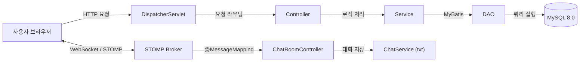
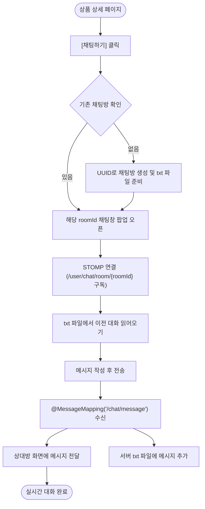
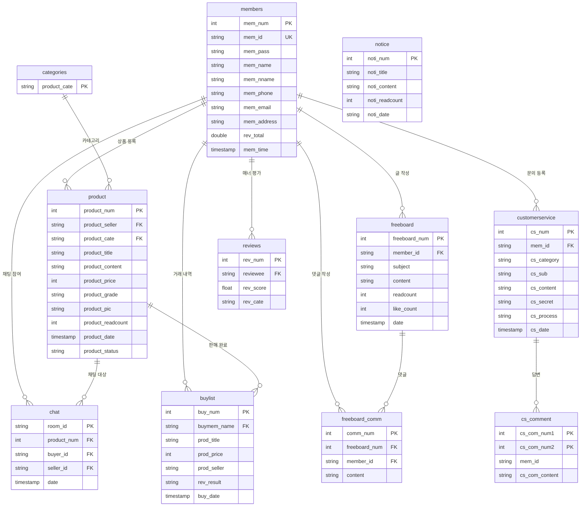

# 🍆 가지마켓 (GajiMarket) - P2P 중고거래 플랫폼

<div align="center">
  
  
  
  
  
  
  
  
</div>

<br>

> **아이티윌 부산 파이널 프로젝트 (Spring MVC 기반 중고거래 웹 서비스)**  
> 당근마켓과 번개장터를 참고하여 개발한 웹 기반 1:1 중고거래 서비스입니다.  
> WebSocket과 STOMP를 활용한 **실시간 1:1 채팅**, 상품 등록/검색/찜하기, 비동기 댓글이 포함된 자유게시판, 고객센터 Q&A 기능을 구현했습니다.

---

## 📸 주요 화면

| 메인 페이지 | 실시간 1:1 채팅 |
|:---:|:---:|
|  |  |
| **조회순·관심순·최신순 슬라이더 & 카테고리** | **WebSocket + STOMP 기반 실시간 1:1 채팅 팝업** |

| 자유게시판 & 댓글 | 상품 상세 페이지 |
|:---:|:---:|
|  |  |
| **게시글 상세 및 AJAX 비동기 댓글 작성/삭제** | **상품 이미지 갤러리, 판매자 다른 상품, 채팅/찜하기** |

---

## 📌 목차
1. [프로젝트 개요](#-프로젝트-개요)
2. [팀 구성 및 역할](#-팀-구성-및-역할)
3. [내가 담당한 기능](#-내가-담당한-기능)
4. [기술 스택](#-기술-스택)
5. [아키텍처 및 흐름도](#-아키텍처-및-흐름도)
6. [데이터베이스 ERD](#-데이터베이스-erd)
7. [기능별 상세 설명 & 고민한 점](#-기능별-상세-설명--고민한-점)
8. [트러블슈팅](#-트러블슈팅)
9. [코드 리팩토링](#-코드-리팩토링)
10. [실행 방법](#-실행-방법)

---

## 📖 프로젝트 개요

- **프로젝트명**: 가지마켓 (GajiMarket)
- **개발 기간**: 2023.02.01 ~ 2023.03.17 (약 7주)
  - `1주차`: 아이디어 선정, 요구사항 분석 및 테이블 설계
  - `2주차`: DB 생성(11개 테이블), 헤더/푸터 공통 UI 레이아웃 작업
  - `3~5주차`: 핵심 기능 구현 (실시간 채팅, 상품 CRUD, 자유게시판, 회원, 고객센터)
  - `6~7주차`: 기능 통합, 오류 수정 및 시연 준비
- **기획 목적**:
  - 중고거래에서 가장 중요한 판매자-구매자 간 소통을 원활하게 하기 위해 **실시간 1:1 채팅**을 중심으로 웹 서비스를 기획했습니다.

---

## 👥 팀 구성 및 역할

| 팀원 | 담당 파트 | 구현 내용 |
|:---:|:---:|:---|
| **최승현** | **실시간 채팅 & 자유게시판** | **• WebSocket + STOMP 기반 1:1 실시간 채팅 구현<br>• 상품 상세 연동 채팅방 자동 생성 및 대화 내용 파일 저장/불러오기<br>• 자유게시판 CRUD 및 AJAX 비동기 댓글 작성/삭제<br>• 공통 UI 레이아웃 모듈화 (Header, Footer, Hero 섹션)<br>• 파일 업로드 경로 동적 처리 및 DB 설정 분리** |
| 김도연 (조장) | 메인 & 상품 상세 | • 메인 페이지 캐러셀 슬라이더, 상품 상세 페이지, 관심상품(찜) 기능 |
| 양성일 | 상품 등록 & 공지사항 | • 다중 이미지 미리보기 업로드, 상품 등록/수정/삭제, 공지사항 게시판 |
| 고보정 | 고객센터 | • 1:1 고객문의 CRUD, 첨부파일 업로드, 비밀글 잠금 모드, 관리자 답변 |
| 한도경 | 거래내역 & 후기 | • 판매/구매 내역 탭 분리, 거래 후기 작성 및 매너 점수 계산 |
| 조보규 | 회원 & 결제 연동 | • 회원가입(우편번호 API), 로그인/마이페이지, ID/PW 찾기, 오픈뱅킹 결제 연동 |

---

## 🌟 내가 담당한 기능

프로젝트에서 **실시간 1:1 채팅**, **자유게시판(댓글 포함)**, **공통 레이아웃** 개발을 담당했습니다.

### 1. 실시간 1:1 채팅
- **WebSocket + STOMP**: 페이지 새로고침 없이 판매자와 구매자가 실시간으로 대화를 나눌 수 있도록 구현했습니다.
- **채팅방 자동 생성**: 상품 상세 페이지에서 [채팅하기]를 누르면 기존에 둘 사이에 생성된 방이 있는지 조회하고, 없으면 `UUID`로 새 방을 생성해 바로 연결합니다.
- **방 번호 기반 메시지 라우팅**: `/user/chat/room/{roomId}` 구독 경로를 사용해 대화 상대방에게만 메시지가 전송되도록 처리했습니다.
- **대화 내역 저장**: 채팅 메시지를 서버 txt 파일에 차례대로 기록하여, 채팅방을 나갔다 다시 들어와도 이전 대화가 그대로 보이도록 구현했습니다.

### 2. 자유게시판 및 AJAX 비동기 댓글
- **게시글 CRUD**: Spring MVC 패턴(Controller - Service - DAO - MyBatis - JSP)에 맞춰 게시글 작성, 조회, 수정, 삭제를 개발했습니다.
- **페이징 및 검색**: `PageDTO`를 만들어 10개 블록 단위 페이징을 구현하고, MyBatis 동적 태그(`<if>`)로 제목 검색을 처리했습니다.
- **비동기 댓글**: 전체 페이지가 새로고침되지 않고 댓글 등록과 삭제가 즉시 화면에 반영되도록 AJAX로 구현했습니다.

### 3. 공통 레이아웃 모듈화
- 사이트 전체에서 공통으로 쓰이는 상단 GNB(Header), 메인 배너(Hero), 하단 정보(Footer)를 독립된 JSP 프래그먼트로 모듈화하여 코드 중복을 줄였습니다.
- 로그인 여부에 따라 상단 메뉴가 [로그인/회원가입] 또는 [마이페이지/로그아웃]으로 바뀌도록 세션 처리를 적용했습니다.

### 4. 경로 호환성 및 설정 정리
- 팀원들의 개발 환경(드라이브 절대경로) 차이로 발생하던 파일 업로드 에러를 동적 경로(`servletContext.getRealPath()`)로 통일했습니다.
- 코드에 직접 적혀 있던 DB 접속 비밀번호를 `database.properties` 파일로 분리했습니다.

---

## 🛠 기술 스택

- **Backend**: `Java 11`, `Spring MVC 4.3.8`, `MyBatis 3.4.1`, `MySQL 8.0`, `Tomcat 9.0`, `Maven`
- **Real-Time**: `WebSocket`, `Spring STOMP`, `Jackson`, `Gson`
- **Frontend**: `JSP 2.1`, `JSTL 1.2`, `jQuery 3.3.1`, `Bootstrap 4.0`, `Owl Carousel`
- **API & Tools**: `Daum 우편번호 API`, `STS 3.9`, `Git / GitHub`

---

## 🏛 아키텍처 및 흐름도

### 기본 구조


### 1:1 실시간 채팅 흐름


---

## 🗄 데이터베이스 ERD

프로젝트에서 사용한 **11개 테이블**의 구조입니다.



---

## ✨ 기능별 상세 설명 & 고민한 점

### 1. 실시간 1:1 채팅
- **화면 구성**: 상품 상세 페이지에서 팝업창으로 채팅방이 열리도록 구성해, 상품 정보를 보면서도 편하게 대화할 수 있게 했습니다.
- **채팅방 목록**: 내가 참여 중인 대화 목록을 확인하고 불필요한 방을 나갈 수 있습니다.

> 💡 **기술 선택과 구현 회고**
> - **순수 WebSocket 대신 STOMP를 선택한 이유**:  
>   기본 WebSocket만 사용하면 세션 ID와 방 번호를 매핑하는 작업을 직접 자바 코드로 관리해야 해서 방이 늘어날수록 관리가 복잡해졌습니다. STOMP의 발행/구독(pub/sub) 방식을 도입하니 `/user/chat/room/{roomId}` 형태로 방 번호만 지정해주면 특정 방 참여자에게만 메시지를 보낼 수 있어서 코드가 훨씬 단순해졌습니다.
> - **채팅 내용을 파일(txt)로 저장했던 이유와 아쉬운 점**:  
>   당시에는 채팅이 칠 때마다 DB 커넥션을 맺고 insert하는 부하를 줄여보고자 `FileOutputStream(append=true)` 방식으로 서버 파일에 직접 쓰는 방식을 택했습니다.  
>   **[회고]**: 단일 PC 환경에서는 빠르게 동작했지만, 서버가 2대 이상으로 늘어나는 분산 환경이라면 다른 서버에 저장된 파일을 읽을 수 없는 한계가 있습니다. 실무 프로젝트라면 **Redis Pub/Sub**으로 메시지를 실시간 전달하고, 대화 내역 저장은 **MongoDB 같은 NoSQL이나 메시지 큐(Kafka)**를 사용하는 것이 훨씬 확장성 있는 구조라는 것을 배웠습니다.

### 2. 자유게시판 & 댓글
- **게시글 관리**: 제목, 내용 작성 및 수정/삭제가 가능하며 목록에서 조회수와 작성일을 확인할 수 있습니다.
- **AJAX 댓글**: 댓글을 달거나 지울 때 페이지가 위로 튀거나 깜빡이지 않도록 `@RestController`로 비동기 처리했습니다.

---

## 🔧 트러블슈팅

### 1. 채팅 메시지가 다른 사람에게 섞이거나 전달이 안 되는 문제
- **문제**: WebSocket 연결 후 메시지를 보낼 때, 1:1 대화방 구분이 제대로 되지 않고 다른 사용자에게 가거나 전달되지 않는 현상이 발생했습니다.
- **원인**: 기본 WebSocket 규격에는 방(Room) 개념이 없어서, 어떤 클라이언트가 어떤 방을 보고 있는지 식별하기 어려웠습니다.
- **해결**: STOMP 프로토콜을 적용해 클라이언트가 `/user/chat/room/{roomId}` 경로를 구독하게 만들고, 서버에서 `SimpMessagingTemplate.convertAndSend()`를 호출해 해당 방 번호를 구독 중인 사람에게만 메시지가 전송되도록 수정했습니다.

### 2. 다른 팀원 컴퓨터에서 실행 시 파일 업로드 오류 (`FileNotFoundException`)
- **문제**: 팀원들의 코드를 합친 후 상품 등록이나 채팅방 생성을 실행하면 파일 경로 에러가 발생했습니다.
- **원인**: 각자 사용하는 로컬 경로(`D:\workspace...`, `E:\...`, `C:\sts...`)가 `servlet-context.xml`에 하드코딩되어 있어서 다른 환경에서는 폴더를 찾지 못했습니다.
- **해결**: 드라이브 절대경로를 지우고 SpEL을 사용해 톰캣 서버의 실제 배포 경로를 가져오도록 수정했습니다:
  ```xml
  <beans:bean id="uploadPath" class="java.lang.String">
      <beans:constructor-arg value="#{servletContext.getRealPath('/resources/upload')}" />
  </beans:bean>
  ```
  `ChatService`에서도 파일 저장 전 부모 폴더가 없으면 `mkdirs()`로 자동 생성하게 보완했습니다.

### 3. freeboardMapper 쿼리 태그 불일치
- **문제**: 자유게시판 글 등록 시 일부 상황에서 매퍼 파싱 관련 경고가 발생했습니다.
- **원인**: `freeboardMapper.xml`에서 insert 쿼리가 `<select id="insert">` 태그로 잘못 감싸져 있었습니다.
- **해결**: `<insert id="insert">` 표준 태그로 교정했습니다.

---

## 📌 코드 리팩토링

프로젝트를 정리하면서 아래 항목들을 깔끔하게 리팩토링했습니다:

| 항목 | 기존 코드 | 개선 내용 |
|---|---|---|
| **DB 계정 보안** | `root-context.xml`에 DB 비밀번호 평문 노출 | `database.properties` 파일로 분리하고 gitignore 처리 |
| **파일 업로드 경로** | 팀원 로컬 드라이브 절대경로 4개 하드코딩 | `#{servletContext.getRealPath(...)}` 동적 경로로 통일 |
| **로그 출력** | `System.out.println` 산발적 사용 | `SLF4J` 로거로 교체하고 패키지별 로그 레벨 지정 |
| **MyBatis 매퍼** | 글 등록 쿼리에 `<select>` 태그 사용 | `<insert>` 태그로 수정 |
| **의존성 충돌** | `jackson-databind` 2개 버전 중복 선언 | 2.13.3 단일 버전으로 통합 |
| **한글 인코딩** | `CharacterEncodingFilter`에 forceEncoding 누락 | `forceEncoding = true` 추가해 POST 한글 깨짐 방지 |

---

## 🚀 실행 방법

### 1. 요구사항
- Java 11, Tomcat 9.0, MySQL 8.0 이상, STS 또는 Eclipse

### 2. DB 접속 정보 설정
`src/main/resources/database.properties` 파일에서 본인의 MySQL 계정 정보를 입력합니다:
```properties
db.driver=com.mysql.cj.jdbc.Driver
db.url=jdbc:mysql://localhost:3306/gajimarket?serverTimezone=Asia/Seoul
db.username=YOUR_USERNAME
db.password=YOUR_PASSWORD
```

### 3. 프로젝트 구동
1. 저장소를 클론합니다:
   ```bash
   git clone https://github.com/cweed2483/UsedMarket.git
   ```
2. STS에서 `Existing Maven Projects`로 Import합니다.
3. Tomcat 9.0 서버에 프로젝트를 등록하고 실행합니다.
4. 브라우저에서 `http://localhost:8080/market/main/main` 으로 접속합니다.

---

<div align="center">
  <b>가지마켓 (GajiMarket) P2P 중고거래 웹 플랫폼</b><br>
  아이티윌 부산 파이널 프로젝트 1조 · 최승현
</div>
