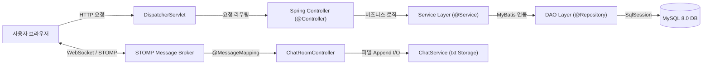
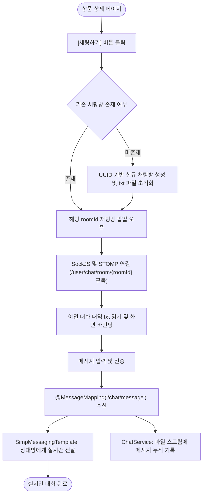
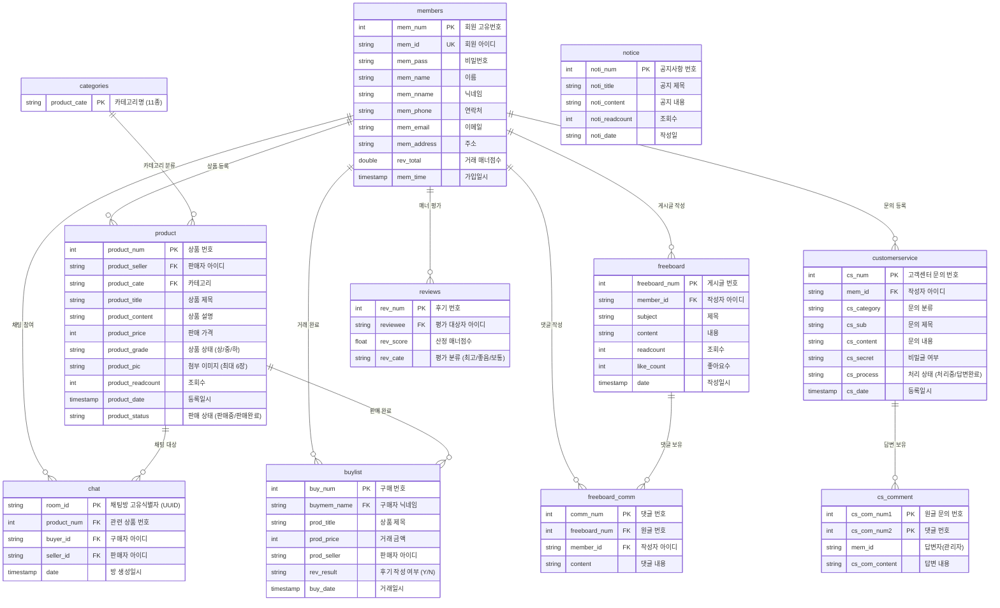

# 🍆 가지마켓 (GajiMarket) - P2P 중고거래 플랫폼

<div align="center">
  
  
  
  
  
  
  
  
</div>

<br>

> **아이티윌 부산 파이널프로젝트 (Spring MVC & WebSocket/STOMP 기반 실시간 P2P 웹 애플리케이션)**  
> **"나가지말고 집에서 편하게 중고거래"**  
> 당근마켓과 번개장터를 벤치마킹하여, 복잡한 중고거래 절차를 간소화하고 **WebSocket + STOMP 기반의 1:1 실시간 채팅**, 상품 등록·다중 이미지 업로드·검색·찜하기, 자유게시판(비동기 댓글), 고객센터 Q&A 및 거래 매너 평가 시스템까지 원스톱으로 제공하는 웹 서비스입니다.

---

## 📸 핵심 화면 미리보기

| 메인 페이지 | 실시간 1:1 채팅 |
|:---:|:---:|
|  |  |
| **조회순·관심순·최신순 캐러셀 & 카테고리 탐색** | **WebSocket+STOMP 기반 1:1 실시간 대화창 (팝업)** |

| 자유게시판 & 비동기 댓글 | 상품 상세 페이지 |
|:---:|:---:|
|  |  |
| **게시글 CRUD 및 AJAX 비동기 실시간 댓글 등록/삭제** | **상품 갤러리 썸네일, 판매자 다른 상품, 채팅/찜하기** |

---

## 📌 목차
1. [프로젝트 개요](#-프로젝트-개요)
2. [팀원 구성 및 담당 역할](#-팀원-구성-및-담당-역할)
3. [최승현 (본인) 핵심 기여 내용](#-최승현-본인-핵심-기여-내용)
4. [기술 스택 (Tech Stack)](#-기술-스택-tech-stack)
5. [시스템 아키텍처 및 서비스 흐름도](#-시스템-아키텍처-및-서비스-흐름도)
6. [데이터베이스 ERD](#-데이터베이스-erd)
7. [주요 기능 상세 & Deep Dive](#-주요-기능-상세--deep-dive)
8. [트러블슈팅 & 문제 해결](#-트러블슈팅--문제-해결)
9. [코드 품질 개선 및 리팩토링](#-코드-품질-개선-및-리팩토링)
10. [설치 및 실행 가이드](#-설치-및-실행-가이드)

---

## 📖 프로젝트 개요

- **프로젝트명**: 가지마켓 (GajiMarket) - P2P 중고거래 플랫폼
- **진행 기간**: 2023.02.01 ~ 2023.03.17 (약 7주)
  - `02.01 ~ 02.07`: 주제 선정, 요구사항 분석 및 기능명세서 작성
  - `02.08 ~ 02.16`: DB 모델링(11개 테이블 ERD), UI/UX 레이아웃 설계(Header/Footer/Hero)
  - `02.17 ~ 03.10`: 도메인별 기능 구현 (실시간 채팅, 상품 CRUD, 자유게시판, 회원, 고객센터)
  - `03.11 ~ 03.17`: 통합 테스트, 예외 처리, 코드 리팩토링 및 최종 발표
- **기획 배경**:
  - 자원 재활용과 가성비 소비 트렌드로 중고거래 수요가 급증함에 따라, 신뢰성 있는 거래 환경 구축 필요성 증대
  - 모바일 앱 수준의 즉각적인 소통 경험을 웹 브라우저에서도 제공하기 위해 **WebSocket/STOMP 프로토콜을 접목한 실시간 1:1 대화 시스템** 구축

---

## 👥 팀원 구성 및 담당 역할

| 이름 | 담당 파트 | 주요 개발 내용 |
|:---:|:---:|:---|
| **최승현 (본인)** | **@실시간 채팅 & 자유게시판** | **• Spring WebSocket + STOMP 기반 1:1 실시간 채팅 시스템 전담 개발<br>• 상품 상세 연동 1:1 채팅방 동적 생성(`UUID`) 및 파일 기반 대화 이력 영구 보존<br>• 자유게시판 CRUD 및 AJAX 비동기 실시간 댓글 시스템 구현<br>• 사이트 공통 UI 컴포넌트화 (Header, Footer, Hero 섹션 모듈화)<br>• 시스템 경로 호환성 및 DB 외부화 리팩토링 주도** |
| **김도연 (조장)** | @메인 & 상품 상세 | • 메인 페이지 캐러셀(조회순/관심순/최신순), 상품 상세 뷰, 관심상품(찜하기) 연동 |
| **양성일** | @상품 등록 & 공지사항 | • 상품 등록(최대 6장 다중 이미지 업로드/미리보기) 및 수정/삭제, 공지사항 관리 |
| **고보정** | @고객센터 (Q&A) | • 고객센터 1:1 문의글 CRUD, 다중 첨부파일(3개), 비밀글 잠금 모드, 관리자 답변 |
| **한도경** | @거래내역 & 후기 | • 판매/구매 내역 목록 및 상태 필터링, 거래 후기 작성 및 거래 매너 점수 산출 로직 |
| **조보규** | @회원 관리 & 결제 연동 | • 회원가입(Daum 우편번호 API), 로그인 세션 관리, 마이페이지, ID/PW 찾기, 오픈뱅킹 API 연동 |

---

## 🌟 최승현 (본인) 핵심 기여 내용

본 프로젝트의 가장 핵심적인 사용자 인터랙션인 **[실시간 1:1 채팅 시스템]**과 커뮤니티 공간인 **[자유게시판 & 비동기 댓글]**, 그리고 전체 서비스의 뼈대인 **[공통 UI 레이아웃]**을 총괄하여 전담 개발했습니다.

### 1. Spring WebSocket + STOMP 기반 1:1 실시간 채팅 시스템
- **전이중(Full-Duplex) 실시간 통신**: HTTP 폴링 방식의 네트워크 낭비 없이, 웹소켓 커넥션을 지속 유지하여 즉각적인 메시지 송수신 구현
- **동적 채팅방 바인딩**: 상품 상세 페이지에서 [채팅하기] 클릭 시 기존 채팅방 여부를 확인하고 없으면 고유 식별자(`UUID`) 기반의 독립 채팅방을 즉시 생성
- **STOMP Pub/Sub 타겟 라우팅**: `/user/chat/room/{roomId}` 단위로 구독 경로를 분리하여 대화 상대방에게만 메시지가 전달되도록 안전한 라우팅 보장
- **대화 이력 영구 보존**: 서버 디스크에 방 번호별 txt 파일(`FileOutputStream`)로 실시간 누적 저장하고, 재입장 시 `BufferedReader`로 이전 대화 내역 완벽 복원

### 2. 자유게시판 CRUD 및 AJAX 비동기 댓글 시스템
- **Spring MVC 표준 패턴 준수**: Controller - Service - DAO - MyBatis - View 계층 구조를 엄격히 분리하여 유지보수성 극대화
- **자체 페이징 알고리즘(`PageDTO`)**: `currentPage`, `pageSize`(15개), `pageBlock`(10개 단위)을 연산하고 SQL `LIMIT #{startRow}, #{pageSize}` 최적화 쿼리 적용
- **동적 검색 필터링**: MyBatis `<if test="search != null">` 태그를 활용해 검색 키워드 유무에 따른 동적 쿼리 처리
- **AJAX 비동기 댓글 (`@RestController`)**: 전체 페이지 새로고침 없이 실시간으로 댓글 작성 및 삭제가 즉시 반영되는 매끄러운 UX 구축

### 3. 공통 UI 레이아웃 모듈화 (Header, Footer, Hero)
- 전역 웹 일관성을 위해 상단 GNB(Header), 메인 비주얼 배너(Hero), 하단 푸터(Footer)를 독립된 JSP 프래그먼트로 분리
- 세션(`sessionScope.memId`)에 따른 로그인/로그아웃/마이페이지 조건부 네비게이션 렌더링 및 11개 카테고리 동적 바인딩

### 4. 전체 시스템 리팩토링 및 안정성 개선
- 하드코딩된 로컬 개발자 절대경로 4개를 SpEL `#{servletContext.getRealPath()}` 기반 동적 경로로 일원화
- 평문 노출된 DB 접속 계정 정보를 `database.properties` 외부 파일로 분리하여 깃허브 공개 시 보안 취약점 원천 차단

---

## 🛠 기술 스택 (Tech Stack)

### Backend
- **Language & Platform**: `Java 11`, `Spring Framework 4.3.8 (Spring MVC)`
- **Persistence Framework**: `MyBatis 3.4.1`, `MyBatis-Spring 1.3.0`
- **Web Server / WAS**: `Apache Tomcat 9.0`
- **Database**: `MySQL 8.0` (`mysql-connector-java 8.0.17`)
- **Build Tool**: `Apache Maven`

### Real-Time Communication
- **Protocol**: `WebSocket (JSR-356)`, `STOMP (Simple Text Oriented Messaging Protocol)`
- **Spring Modules**: `spring-websocket 4.3.8`, `spring-messaging 4.3.8`, `spring-integration-stomp`
- **Data Serialization**: `Jackson Databind 2.13.3`, `Gson 2.8.6`

### Frontend
- **Languages & View**: `JSP 2.1`, `JSTL 1.2`, `HTML5`, `CSS3`, `JavaScript (ES5/ES6)`
- **Framework & Libraries**: `jQuery 3.3.1`, `Bootstrap 4.0`, `Owl Carousel` (슬라이더), `Nice Select`

### External APIs & Tools
- **APIs**: `Daum 우편번호 도로명 주소 API`, `오픈뱅킹 REST API (결제 프로토타입)`
- **Collaboration & Tools**: `GitHub`, `STS (Spring Tool Suite 3.9)`, `Log4j / SLF4J`

---

## 🏛 시스템 아키텍처 및 서비스 흐름도

### Spring MVC & WebSocket 아키텍처
HTTP 요청은 Spring MVC의 `DispatcherServlet`을 통해 처리되며, 실시간 채팅 데이터는 `WebSocketHandler`와 STOMP 메시지 브로커를 통해 전이중으로 송수신됩니다.



### 1:1 실시간 채팅 서비스 흐름도


---

## 🗄 데이터베이스 ERD

총 **11개 테이블**로 구성되어 있으며 정규화 및 관계형 무결성을 확보했습니다.



---

## ✨ 주요 기능 상세 & Deep Dive

### 1. 실시간 1:1 채팅 시스템 (최승현 담당)
- **STOMP 기반 1:1 메시징**: `/user/chat/room/{roomId}` 목적지 구독을 통한 방별 안전한 메시지 분기
- **채팅 팝업창 연동**: 상품 상세에서 [채팅하기] 클릭 시 독립 윈도우 팝업으로 채팅창 오픈
- **채팅방 목록 관리**: 내가 참여 중인 모든 채팅방 목록 조회(`/chat/rooms`) 및 나가기/삭제 기능
- **이전 대화 기록 보존**: 상대방이 오프라인일 때에도 이전 대화 내역이 txt 파일로 안전하게 기록 및 복원

> 💡 **기술적 의사결정 (Why & Deep Dive)**
> - **단순 WebSocket 대신 Spring STOMP를 선택한 이유**:  
>   순수 `WebSocket`은 단순 텍스트/바이트 전송 규약일 뿐이라, 특정 방(`roomId`)에 속한 사용자만 골라서 메시지를 보내려면 세션 ID와 방 번호를 매핑하는 복잡한 라우팅 로직을 직접 구현해야 합니다.  
>   반면 **STOMP**는 `pub/sub(발행/구독)` 구조를 기본 지원하므로, `/user/chat/room/{roomId}` 형태로 토픽을 구독하게 만들어 **코드 복잡성을 획기적으로 줄이고 1:1 타겟 메시징을 안정적으로 구현**할 수 있었습니다.
> - **채팅 이력을 파일(txt) 기반으로 관리한 배경과 실무적 고찰**:  
>   프로토타입 환경에서 메시지 전송마다 빈번하게 DB Connection을 점유하고 트랜잭션을 거치는 오버헤드를 분산시키고자 `FileOutputStream(append=true)`을 활용한 파일 기반 저장 방식을 채택했습니다.  
>   **[실무 관점의 고찰]**: 파일 기반 I/O는 단일 서버에서는 간단하지만, 다중 서버(Scale-Out) 환경에서는 디스크 동기화 및 I/O 병목이 발생할 수 있습니다. 실무 프로덕션 환경이라면 **Redis Pub/Sub**을 통해 실시간 메시지를 브로드캐스팅하고, 영구 보관용 데이터는 **MongoDB 같은 NoSQL 또는 분산 메시지 큐(Kafka)**에 적재하는 방식이 대규모 트래픽 처리에 적합하다는 점을 학습했습니다.

### 2. 자유게시판 & 비동기 댓글 (최승현 담당)
- **게시글 CRUD**: 자유로운 커뮤니티 글 작성, 수정, 삭제 및 조회수 카운트
- **페이징 및 검색**: `PageDTO`를 활용한 10개 단위 블록 페이징 및 키워드 기반 동적 검색
- **비동기 댓글**: `@RestController` 기반 AJAX 통신을 통해 화면 깜빡임 없는 댓글 등록 및 작성자 전용 삭제 기능

### 3. 공통 UI 레이아웃 모듈화 (최승현 담당)
- **Header**: 상단 로고, 11개 카테고리 드롭다운, 통합 검색바, 세션 상태에 따른 [로그인/회원가입] 분기
- **Hero**: 메인 비주얼 배너 및 좌측 카테고리 네비게이션
- **Footer**: 사이트 정보, 이용약관, 고객센터 바로가기

### 4. 상품 관리 및 찜하기
- **상품 등록**: 최대 6장 이미지 다중 업로드, 드래그앤드롭 미리보기, 상태(상/중/하) 및 카테고리 설정
- **상품 목록 및 필터링**: 카테고리별 분류, 가격 범위 필터링, 최신순/조회순/관심순 정렬 및 AJAX 더보기
- **관심상품 (찜하기)**: 하트 아이콘 클릭 시 비동기 찜 등록/취소 및 마이페이지 관심내역 연동

### 5. 회원 관리 및 인증
- **회원가입**: 아이디 중복 확인(AJAX), 비밀번호 유효성 검사, Daum 우편번호 도로명 주소 API 연동
- **로그인/로그아웃**: `HttpSession`을 활용한 로그인 세션 유지, 아이디/임시비밀번호 찾기
- **마이페이지**: 개인정보 수정, 거래 매너 점수 확인, 회원 탈퇴

### 6. 고객센터 (Q&A) 및 공지사항
- **1:1 문의게시판**: 비밀글 체크 시 작성자와 관리자만 열람 가능한 보안 모드, 다중 파일 첨부
- **관리자 공지사항**: 운영자 전용 공지글 작성 및 이미지 업로드, 페이징

### 7. 판매/구매 내역 및 거래 매너 평가
- **거래내역 관리**: 회원의 판매중/판매완료 내역 및 구매 완료 내역 탭 분리 제공
- **매너 점수 시스템**: 거래 완료 후 이모티콘 및 체크박스 기반 매너 평가를 통해 개인 매너 점수(기본 20점) 동적 증감

---

## 🔧 트러블슈팅 & 문제 해결

### 1. WebSocket 세션 식별 및 STOMP 기반 타겟 라우팅 개선
- **문제 현상**: 순수 WebSocket만으로 구현 시, 서로 다른 상품의 사용자가 메시지를 보낼 때 전체 사용자에게 메시지가 브로드캐스트되거나 세션 구분이 불가능한 문제 발생.
- **원인 분석**: 기본 웹소켓 규격에는 방 번호(`roomId`)나 구독자 개념이 없어, 메시지 헤더에 방 정보를 직접 파싱하고 세션 맵을 관리해야 하는 한계 존재.
- **해결 방법**:
  - `spring-websocket`과 `spring-messaging`에 **STOMP 서브프로토콜을 도입**.
  - 클라이언트가 `/user/chat/room/{roomId}`를 구독하게 하고, 컨트롤러에서 `SimpMessagingTemplate.convertAndSend()`를 호출하여 **해당 방의 참여자에게만 타겟팅된 메시지 전송 구조로 해결**.

### 2. 팀원 간 협업 시 로컬 개발 절대경로 충돌 (`FileNotFoundException`) 해결
- **문제 현상**: 팀원별 로컬 환경(드라이브 명: `D:\workspace...`, `E:\Spring...`, `C:\sts...`)이 달라 다른 팀원의 코드를 Pull 받으면 이미지 업로드 및 채팅 파일 생성 시 즉시 `FileNotFoundException` 발생.
- **원인 분석**: `servlet-context.xml` 내의 파일 업로드 경로 Bean에 개발자의 특정 로컬 드라이브 절대경로가 하드코딩되어 있었음.
- **해결 방법**:
  - Spring SpEL(Spring Expression Language)을 활용하여 **서블릿 컨텍스트 기반의 동적 상대경로 추출 방식으로 리팩토링**:
    ```xml
    <!-- Before: D:\workspace_sts2\...\resources\upload -->
    <!-- After: 환경에 구애받지 않는 동적 웹루트 상대경로 자동 매핑 -->
    <beans:bean id="uploadPath" class="java.lang.String">
        <beans:constructor-arg value="#{servletContext.getRealPath('/resources/upload')}" />
    </beans:bean>
    ```
  - `ChatService`에서도 파일 생성 전 `txtFile.getParentFile().mkdirs()` 방어 로직을 추가하여 디렉터리 부재 에러를 원천 방지.

### 3. 대용량 동시성 트래픽 대비 파일 I/O의 한계와 실무적 고찰
- **문제 현상**: 동시 다발적으로 다수의 사용자가 채팅을 칠 경우 파일 스트림 쓰기 경합 및 디스크 I/O 병목 우려.
- **원인 분석**: 프로토타입 환경에서 DB 커넥션 부하를 피하고자 txt 파일 `FileOutputStream(append=true)` 방식을 사용했으나, 분산 환경(Scale-Out)에서는 서버 간 파일 공유가 불가능한 구조적 한계 인식.
- **해결 방법 및 고찰**:
  - 현재 시스템에서는 `FileOutputStream` 동기화 보강 및 방별 파일 분할로 경합을 최소화.
  - **[실무 관점의 대안 도출]**: 실무 환경이라면 분산 인메모리 저장소인 **Redis Pub/Sub**을 메시지 브로커로 사용하여 서버 간 메시지를 전파하고, 대화 이력 저장은 **MongoDB(NoSQL) 또는 Kafka 메시지 큐**를 통해 비동기 배치 적재하는 구조가 적합함을 도출하고 정리.

### 4. MyBatis 매퍼 XML 내 INSERT 쿼리 태그 정합성 교정
- **문제 현상**: 자유게시판 글 등록 시 일부 환경에서 문법 경고 및 매퍼 파싱 이슈 발생.
- **원인 분석**: `freeboardMapper.xml`의 글 등록 쿼리가 `<select id="insert">` 태그로 잘못 감싸져 있어 DDL/DML 표준 불일치.
- **해결 방법**: `<insert id="insert">` 표준 태그로 교정하고 결과 매핑 규칙을 정상화하여 쿼리 신뢰성 확보.

---

## 📌 코드 품질 개선 및 리팩토링

포트폴리오 완성도와 보안 표준을 위해 프로젝트 전반에 걸쳐 아래 리팩토링을 완료했습니다:

| 개선 영역 | 기존 상태 (Before) | 개선 후 (After) | 기대 효과 |
|---|---|---|---|
| **보안 (Security)** | `root-context.xml`에 DB 주소 및 비밀번호(`1234`) 평문 노출 | `database.properties` 파일로 분리 및 Git 커밋 제외 | 민감정보 외부 노출 원천 차단 |
| **이식성 (Portability)** | 4개의 로컬 절대경로 하드코딩 (`D:\...`, `E:\...`) | SpEL `#{servletContext.getRealPath(...)}` 동적 경로 적용 | 어떤 서버/PC 환경에서도 설정 변경 없이 즉시 구동 |
| **로깅 (Logging)** | 산발적인 `System.out.println()` 사용 | `SLF4J` + `Log4j` 표준 로거 적용 및 패키지별 로깅 레벨 지정 | 서버 I/O 병목 방지 및 운영 추적성 확보 |
| **MyBatis 쿼리** | 자유게시판 INSERT 쿼리가 `<select>` 태그로 작성됨 | `<insert id="insert">` 표준 태그로 교정 | 프레임워크 표준 준수 및 예외 발생 예방 |
| **의존성 정리** | `jackson-databind` 중복 선언 (2.13.3 & 2.11.3 충돌) | 단일 버전 통합 및 미사용 import(Protobuf 등) 정리 | 라이브러리 버전 충돌 방지 및 컴파일 최적화 |
| **인코딩 안정성** | `CharacterEncodingFilter`에 `forceEncoding` 누락 | `forceEncoding = true` 추가 | POST 요청 및 응답 시 한글 깨짐 현상 원천 방지 |

---

## 🚀 설치 및 실행 가이드

### 1. 환경 요구사항
- **Java**: JDK 11
- **Server**: Apache Tomcat 9.0
- **Database**: MySQL 8.0 이상
- **IDE**: STS (Spring Tool Suite 3.9) 또는 Eclipse / IntelliJ IDEA

### 2. 데이터베이스 설정 (`database.properties`)
`src/main/resources/database.properties` 파일의 DB 접속 계정 정보를 로컬 환경에 맞게 수정합니다:
```properties
db.driver=com.mysql.cj.jdbc.Driver
db.url=jdbc:mysql://localhost:3306/gajimarket?serverTimezone=Asia/Seoul
db.username=YOUR_USERNAME
db.password=YOUR_PASSWORD
```

### 3. 프로젝트 빌드 및 실행
1. 저장소 클론:
   ```bash
   git clone https://github.com/cweed2483/UsedMarket.git
   ```
2. STS/Eclipse에서 `Existing Maven Projects`로 Import 후 Maven Update 실행 (`Alt + F5`).
3. Apache Tomcat 9.0 서버에 `Final_Project`를 등록합니다.
4. 브라우저에서 아래 URL로 접속합니다:
   ```
   http://localhost:8080/market/main/main
   ```

---

<div align="center">
  <b>가지마켓 (GajiMarket) P2P 중고거래 웹 플랫폼</b><br>
  아이티윌 부산 파이널 프로젝트 1조 | 기여 개발자: <b>최승현</b>
</div>
